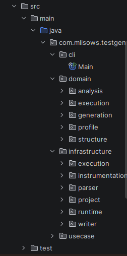
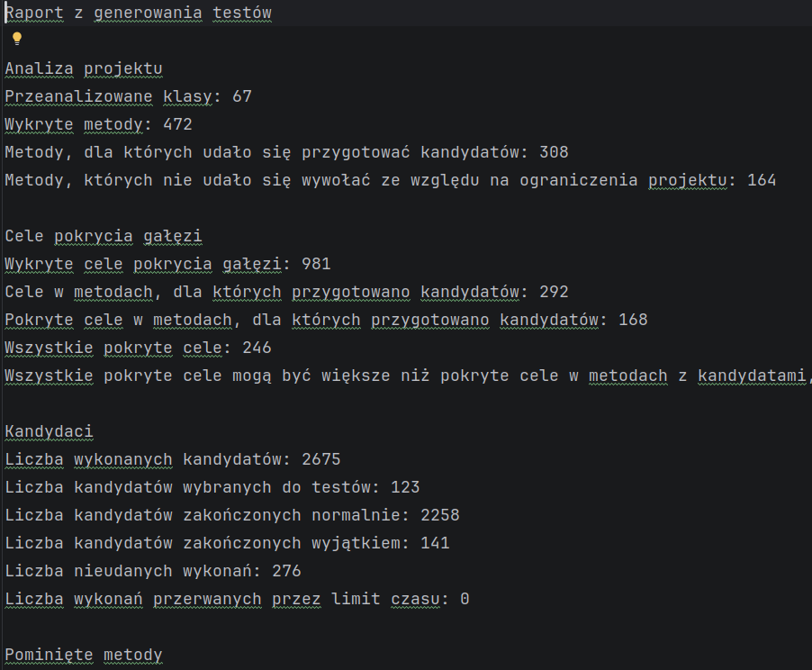

# testgen

`testgen` - to system automatycznego generowania  testow jednostkowych dla aplikacji Java.

Jest to generator, ktory laczy statyczna analize kodu, instrumentacje, wykonywanie kandydatow testow, i selekcje tych kandydatow na podstawie pokrytych galezi programu.

TLDR przepływu:

- program analizuje projekt Maven i sprawdza, czy ma standardowy układ z
  `pom.xml` oraz katalogiem `src/main/java`,
- potem w analizie statycznej, za pomocą javaparsera, znajduje pliki źródłowe `.java` i na ich podstawie rozpoznaje
  klasy, konstruktory, metody, parametry
- nastepnie wykrywa cele pokrycia gałęzi, na przykład gałęzie
  instrukcji `if`, `for`, `while` i `switch`,
- z warunków w kodzie próbuje wyciągnąć podpowiedzi wartości argumentów, np. liczby graniczne, napisy albo wartości enumów,
- dla metod, które mieszczą się w aktualnych ograniczeniach projektu,
  przygotowuje kandydatów testów, czyli konkretne wywołania metod razem z
  potrzebnymi obiektami i argumentami,
- opcjonalnie wykorzystuje observed profile, czyli wartości argumentów
  zaobserwowane podczas wcześniejszego uruchomienia instrumentowanej aplikacji (tworzenie tej instrumentowanej kopii to oddzielny flow programu)
- tworzy instrumentowaną kopię badanego projektu, aby podczas uruchamiania
  kandydatów można było sprawdzić, które gałęzie kodu zostały faktycznie
  wykonane,
- uruchamia kandydatów testów w trakcie działania programu i zapisuje wynik każdego wykonania
- wybiera do końcowego zestawu te kandydaty, które zwiększają pokrycie celów  gałęzi,
- na końcu zapisuje testy JUnit 5 oraz raport tekstowy opisujący analizę
  projektu, liczbę kandydatów i uzyskane pokrycie.

## Dokumentacja

W repozytorium znajduje się dokładniejsza dokumentacja:

- [PROJECT_DOCUMENTATION.md](PROJECT_DOCUMENTATION.md)

Wyniki eksperymentów i wykresy znajdują się w katalogu:

```text
docs/experiment-results
```

Opis zawartości katalogu znajduje się w [docs/experiment-results/README.md](docs/experiment-results/README.md).

## Uruchamianie

1. Poprzez docker compose

Najpierw zbuduj obraz:

```bash
docker compose build
```

wygeneruj testy dla przykladowego projektu:

```bash
docker compose run --rm generate-tests
```

Wyniki pojawia sie w:

```text
target/test-work/fit-bench/generated-tests
target/test-work/fit-bench/report.txt
target/test-work/fit-bench/covered-goals.json
```

- `generated-tests` - wygenerowane testy JUnit,
- `report.txt` - raport z analizy i ustawienia generowania,
- `covered-goals.json` - identyfikatory pokrytych celow.

## Uruchomienie z profilem runtime

Program potrafi korzystac z wartosci argumentow zaobserwowanych podczas rzeczywistego uruchomienia aplikacji. Repozytorium zawiera gotowy profil dla przykladowego projektu:

```text
examples/fit-bench/observed-profile.txt
```

Testy z profilem runtime mozna wygenerowac tym samym serwisem Docker Compose:

```bash
docker compose run --rm generate-tests-with-profile
```

Wyniki pojawia sie w:

```text
target/test-work/fit-bench-with-profile/generated-tests
target/test-work/fit-bench-with-profile/report.txt
target/test-work/fit-bench-with-profile/covered-goals.json
```

Profil mozna tez przygotowac samodzielnie. Najpierw trzeba utworzyc instrumentowana kopie projektu:

```bash
docker compose run --rm prepare-profile
```

Ten krok zapisuje instrumentowane zrodla i skompilowane klasy w katalogu:

```text
target/docker-profile-work/fit-bench
```

Nastepnie trzeba uruchomic przykladowa aplikacje na tej instrumentowanej kopii:

```bash
docker compose run --rm record-profile
```

Po tym kroku powstaje plik:

```text
target/docker-profile-work/fit-bench/observed-profile.txt
```

## Uruchomienie lokalne

Wymagania:

- Java 21,
- Maven,
- projekt Maven, ktory ma standardowy katalog `src/main/java`. (przykładowy jest w `examples/fit-bench`)

`mvn -version` powinno pokazywac Java 21. Jeśli nie, w systemie Ubuntu mozna ustawic JDK 21 dla biezacego terminala:

```bash
export JAVA_HOME=/usr/lib/jvm/java-21-openjdk-amd64
export PATH="$JAVA_HOME/bin:$PATH"
```


Uruchomienie testow projektu `testgen`:

```bash
mvn test
```

Zbudowanie programu i skopiowanie zaleznosci:

```bash
mvn -q -DskipTests package dependency:copy-dependencies
```

Wygenerowanie testow dla przykladowego projektu:

```bash
java -cp "target/classes:target/dependency/*" \
  com.mlisows.testgen.cli.Main \
  examples/fit-bench \
  target/test-work/fit-bench-local
```

Ogolna postac polecenia:

```text
testgen <maven-project-root> [work-root] [observed-profile|-]
        [seed] [max-candidates] [initial-candidates]
        [mutated-initial-candidates] [max-values-per-slot]
```

Parametry generowania maja nastepujace wartosci domyslne:

- `seed=0` - ziarno losowania,
- `max-candidates=50` - limit kandydatow na metode,
- `initial-candidates=10` - liczba prob utworzenia kandydatow losowych,
- `mutated-initial-candidates=3` - limit losowych kandydatow poddawanych mutacji,
- `max-values-per-slot=10` - limit wartosci argumentu wykorzystywanych w mutacjach.

Znak `-` oznacza brak profilu, gdy podawane sa dalsze parametry. Przyklad:

```bash
java -cp "target/classes:target/dependency/*" \
  com.mlisows.testgen.cli.Main \
  examples/fit-bench \
  target/test-work/fit-bench-local \
  - 42 120 30 3 10
```

Tryb przygotowania profilu runtime:

```text
testgen prepare-profile <maven-project-root> [work-root]
```

## Przykladowy projekt

Przykladowy projekt testowy znajduje sie w:

```text
examples/fit-bench
```

Jest to zwykly projekt Maven z klasami domenowymi, enumami, konstruktorami, metodami i galeziami sterowania. Projekt zostal wygenerowany automatycznie,w taki sposob żeby miescił się w ograniczeniach aktualnego generatora.


## Jak dziala generator

Glowne wejscie programu znajduje sie w klasie:

```text
src/main/java/com/mlisows/testgen/cli/Main.java
```

Przeplyw generowania testow jest nastepujacy:

1. Program rozpoznaje uklad projektu Maven. Sprawdza katalog projektu, `pom.xml`, `src/main/java` i opcjonalne zasoby.
2. Program znajduje pliki `.java` w katalogu z kodem produkcyjnym.
3. JavaParser buduje indeks typow. Dzieki temu generator wie, ktore pliki opisuja klasy, enumy albo interfejsy.
4. Generator analizuje kod metod i wykrywa cele pokrycia galezi. Aktualnie obslugiwane sa przede wszystkim `if`, `for`, `while` i `switch`.
5. Generator zbiera statyczne podpowiedzi wartosci argumentow. Przykladowo warunek `amount > 100` moze dac podpowiedz wartosci bliskich `100`.
6. Generator analizuje strukture klas. Odczytuje konstruktory, metody, parametry, typy argumentow i typy zwracane.
7. Planner metod sprawdza ograniczenia generatora. Odrzucane sa metody, ktorych aktualna wersja programu nie umie  obsluzyc, na przykład List<> jako parametr.
8. Program opcjonalnie wczytuje profil runtime z pliku tekstowego. Profil zawiera wartosci argumentow zaobserwowane podczas prawdziwego uruchomienia instrumentowanej aplikacji.
9. Program tworzy instrumentowana kopie projektu. Do kodu zrodlowego dodawane sa wywolania runtime recorderow - ta kopia jest kompilowana do osobnego katalogu.
10. Generator tworzy przestrzenie kandydatow. Dla kazdej metody, którą jestesmy w stanie obsłużyć biorąc pod uwagę ograniczenia naszego projektu, probujemy zbudowac obiekt docelowy, potrzebne obiekty pomocnicze (jak konstruktory klas zależnych) i argumenty metody.
11. Generator tworzy warianty kandydatow. Korzysta z wartosci pobranych w analizie statycznej, wartosci pobrane z rzeczywistego działania programu, wartosci domyslnych, i prostych mutacji.
12. Kandydaci sa wykonywani przez refleksje na instrumentowanej kopii projektu -  `BranchRecorder` zapisuje, ktore cele pokrycia zostaly trafione podczas wykonania kandydata.
13. Do koncowych testow wybierani sa kandydaci, ktorzy dodali nowe pokrycie.
14. Program zapisuje wygenerowane testy JUnit i raport.

## Architektura

Korzystamy w dużej mierze z Clean Architecture:

```text
src/main/java/com/mlisows/testgen/domain
src/main/java/com/mlisows/testgen/usecase
src/main/java/com/mlisows/testgen/usecase/ports
src/main/java/com/mlisows/testgen/infrastructure
src/main/java/com/mlisows/testgen/cli
```

Warstwy:

- `domain` - modele danych, na przyklad kandydat testu, cel pokrycia, plan metody, struktura klasy,
- `usecase` - logika generowania kandydatow, mutacji, oceny pokrycia i raportowania,
- `usecase/ports` - porty które implementujemy w warstwie infrastruktury,
- `infrastructure` - implementacje, np. analizy przez JavaParser, kompilacji plików, wykonywania kandydatów, czy runtime recorderów zbierających rzeczywiste wartości parametrów metod i konstruktorów które pojawiły się w trakcie działania zewnętrznego projektu,
- `cli` - punkt wejscia programu.




## Co jest zaimplementowane

Zakres projektu:

- analiza projektow Maven,
- analiza klas, metod, konstruktorow i parametrow,
- analiza struktur klas i enumow,
- wykrywanie galezi `if`, `for`, `while` i `switch`,
- statyczne podpowiedzi wartosci argumentow,
- profil  z wartosciami argumentow które rzeczywiście wystąpiły w zewnętrznym projekcie,
- instrumentacja kodu do mierzenia pokrycia galezi,
- instrumentacja kodu do zapisu wartosci argumentow runtime,
- generowanie kandydatow testow,
- rekurencyjne budowanie obiektow pomocniczych przez publiczne konstruktory,
- generowanie wariantow i prostych mutacji argumentow,
- wykonywanie kandydatow przez refleksje,
- selekcja kandydatow na podstawie nowego pokrycia,
- zapis testow JUnit 5,
- raport tekstowy


## Ograniczenia

- brak wsparcia dla kolekcji, map, list
- brak  mockowania zaleznosci,
- brak obsługi Spring i innych frameworkow,
- brak pelnego odtwarzania sesji uzytkownika(jest rekurencyjne budowanie obiektów, czyli metod i potrzebnych konstruktorów, ale nie ma odtwarzenia sekwencji metod które mogłyby pokryć nowy cel)
- brak obslugi galezi  w lambdach, streamach, operatorze trojargumentowym i skrotowych warunkach logicznych,


Raport generowania pokazuje te ograniczenia: ile metod przeszlo podstawowe reguly, dla ilu faktycznie udalo sie przygotowac kandydatow i ile celow pokrycia znajduje sie w metodach, ktore generator byl w stanie wywolac.




## Wywołanie generatora z kodu Javy

Wymagane jest JDK 21. CLI zachowuje dotychczasowe argumenty i format plików,
ale logikę obu trybów można również wywołać bez `Main`:

```java
import com.mlisows.testgen.domain.profile.ObservedProfile;
import com.mlisows.testgen.infrastructure.TestgenUseCases;
import com.mlisows.testgen.domain.generation.GenerationSettings;
import com.mlisows.testgen.usecase.generation.GenerationRequest;
import com.mlisows.testgen.usecase.profile.ProfilePreparationRequest;
import java.nio.file.Path;
import java.util.List;

var generator = TestgenUseCases.generation();
var result = generator.generate(new GenerationRequest(
        Path.of("examples/fit-bench"),
        Path.of("target/api-demo"),
        GenerationSettings.defaults(),
        new ObservedProfile(List.of(), List.of())));

// Wyniki są w pamięci: treść testów, raport i identyfikatory pokrytych celów.
var tests = result.tests();
var report = result.reportText();
var coveredGoals = result.coveredGoalIds();

var profileWorkspace = TestgenUseCases.profilePreparation().prepare(
        new ProfilePreparationRequest(
                Path.of("examples/fit-bench"), Path.of("target/profile-demo")));
```

`GenerateTestsUseCase` przyjmuje gotowy `ObservedProfile`. Odczyt pliku przez
`TextObservedProfileReader` pozostaje po stronie wywołującego; w przyszłości
profil będzie mógł pochodzić z bazy. Wynik zawiera testy jako pary względnej
ścieżki i treści. CLI zapisuje je przez `GeneratedCandidateTestFileWriter.writeFiles`.
Sam przypadek użycia zapisuje przez adapter robocze źródła i klasy potrzebne
do wykonania kandydatów, ale nie zapisuje końcowych testów ani raportów.

`PrepareProfileUseCase` tworzy lokalny katalog z instrumentowanymi źródłami,
klasami i zasobami. Zwraca też classpath do uruchomienia aplikacji oraz ścieżkę,
pod którą recorder zapisze profil po jej uruchomieniu. Nie uruchamia aplikacji
ani nie tworzy przenośnej paczki projektu.

`TestgenUseCases` składa domyślne adaptery Maven/JavaParser. Klasy w `usecase`
korzystają z portów i nie importują infrastruktury ani Springa. Późniejsza
konfiguracja Springa będzie mogła złożyć ten sam zestaw zależności.

Generowania trzeba wykonywać kolejno w obrębie jednej JVM ze względu na
statyczny recorder pokrycia. Każde wywołanie tworzy własny generator losowy,
a osobne katalogi robocze pozwalają zachować artefakty poszczególnych uruchomień.

Testy projektu:

```bash
mvn test
```

Polecenie wymaga, aby Maven korzystał z JDK 21 (`mvn -version`).

Nowe operacje są pogrupowane w pakietach `usecase.generation` i
`usecase.profile`, razem z ich żądaniami i wynikami. `GenerationSettings`
znajduje się w `domain.generation`, ponieważ opisuje parametry algorytmu.
Ścieżki robocze i classpath pozostają w kontraktach przypadków użycia.

## Serwer Spring Boot

Wymagane JDK 21. Uruchomienie lokalne:

```bash
mvn spring-boot:run
```

Serwer domyślnie nasłuchuje na porcie 8080. Lista skonfigurowanych projektów:

```bash
curl -i http://localhost:8080/api/projects
```

Odpowiedź: `200 OK`, domyślnie `[{"id":"fit-bench"}]`.
Endpoint zwraca identyfikatory bez lokalnych ścieżek projektów.
Żądanie `GET /` nadal zwraca 404.

Uruchomienie z JAR-a:

```bash
mvn clean package dependency:copy-dependencies -DincludeScope=runtime
java -jar target/testgen-1.0-SNAPSHOT-server.jar \
  --testgen.runner.classpath="target/testgen-1.0-SNAPSHOT.jar:target/dependency/*"
```

Port można zmienić argumentem `--server.port=8081`. Zatrzymanie: `Ctrl+C`.
Dotychczasowe CLI i Docker Compose nadal służą do generowania testów oraz
przygotowania profilu.

Konfiguracja serwera znajduje się w `src/main/resources/application.yml`:
`testgen.projects` określa dostępne projekty, `testgen.work-root` katalog roboczy,
a `testgen.defaults` domyślne parametry generowania. Ścieżki względne są liczone
od katalogu uruchomienia aplikacji. Domyślnie dostępny jest `examples/fit-bench`.
Przy starcie sprawdzane są parametry i struktura skonfigurowanych projektów Maven.


Wykonawca zadań uruchamia generator w osobnej JVM. Limit wykonania określa
`testgen.runner.timeout-seconds` (domyślnie 120). Przy uruchomieniu przez Maven
classpath jest dziedziczony z procesu serwera. Dla wykonywalnego JAR-a Boota
trzeba podać `testgen.runner.classpath` ze zwykłym JAR-em i jego zależnościami,
jak wyżej; na Windows separatorem classpath jest `;`.

Wyniki robocze trafiają do `<request.workRoot>/<jobId>/`: `request.json`,
`result.json`, `process.log` oraz `workspace/`. Katalog zadania nie może już
istnieć; ponowne zlecenie wymaga nowego identyfikatora. JSON jest wewnętrznym
formatem komunikacji między procesami tej samej wersji programu, nie publicznym API.
Po timeoutcie lub przerwaniu wykonawca zatrzymuje proces oraz zaobserwowane procesy
potomne. Osobna JVM nie stanowi sandboxa dla niezaufanego kodu.
Zlecenie generowania bez profilu:

```bash
curl -i -X POST http://localhost:8080/api/generations \
  -H 'Content-Type: application/json' \
  -d '{"projectId":"fit-bench","seed":42,"maxCandidates":50}'
```

Odpowiedź `202 Accepted` zawiera identyfikator, status przyjęcia `QUEUED`, efektywne
ustawienia i nagłówek `Location: /api/jobs/<id>`. Aktualny status odczytasz przez:

```bash
curl http://localhost:8080/api/jobs/<id>
```

Zadanie może już wykonywać się w chwili otrzymania odpowiedzi `202`. `GET` zwraca
bieżący status, czasy, ustawienia oraz podsumowanie po sukcesie albo ogólny komunikat
błędu. Szczegóły techniczne błędu pozostają w logach serwera i procesu generatora.

Wymagany jest `projectId`. Opcjonalne pola `seed`, `maxCandidates`,
`initialCandidates`, `mutatedInitialCandidates` i `maxValuesPerSlot` nadpisują
`testgen.defaults`; pominięcie pola lub `null` oznacza wartość domyślną.
Nieobsługiwane pola dają `400`. Opcjonalne `profileId` wskazuje wcześniej zaimportowany
profil przypisany do tego samego projektu. Pominięcie `profileId` lub `null` oznacza
generowanie bez profilu. Niepoprawny UUID daje `400`, nieznany profil `404`,
a profil należący do innego projektu `400`. Odpowiedź na zlecenie i odczyt statusu
zawierają `profileId` użytego profilu (lub `null`).

Raport zakończonego sukcesem zadania pobierzesz jako plik tekstowy UTF-8:

```bash
curl --fail "http://localhost:8080/api/jobs/<id>/report" -o report.txt
```

Endpoint zwraca `200` i nagłówek `Content-Disposition: attachment` z nazwą
`report-<id>.txt`. Nieznane zadanie daje `404`, a istniejące zadanie bez wyniku
(np. oczekujące, wykonywane lub zakończone błędem) daje `409`.

Wygenerowane testy pobierzesz jako archiwum ZIP:

```bash
curl --fail "http://localhost:8080/api/jobs/<id>/tests" -o tests.zip
```

Archiwum `tests-<id>.zip` zawiera pliki Javy w katalogach odpowiadających pakietom.
Treść plików jest kodowana w UTF-8. Jeśli generowanie zakończyło się sukcesem,
ale nie utworzyło testów, pobierzesz poprawne puste archiwum. Kody `404` i `409`
mają takie samo znaczenie jak przy pobieraniu raportu.

Kolejka wykonuje jedno zadanie naraz. `testgen.queue-capacity` określa liczbę
oczekujących zadań (domyślnie 10, poza jednym aktywnym). Błędne dane dają `400`,
nieznany projekt lub zadanie `404`, a pełna lub zamykana kolejka `503`.
Odpowiedź `503` zawiera `jobId` odrzuconego zadania, które pozostaje jako `FAILED`;
ponowienie oznacza wysłanie nowego zlecenia. Błędy HTTP mają format Problem Details.

Przy zamykaniu serwera aktywne wykonanie jest przerywane, a oczekujące zadania
oznaczane jako `FAILED`. Historia i wyniki znajdują się w pamięci i znikają po
restarcie. Limit kolejki nie ogranicza rozmiaru zachowanej historii ani plików
roboczych; automatyczne usuwanie starych wyników nie jest jeszcze zaimplementowane.

### Import profilu przez API

Plik `observed-profile.txt` przygotowany przez istniejący tryb CLI można przesłać
jako pole `file` formularza multipart:

```bash
curl -i -X POST http://localhost:8080/api/projects/fit-bench/profiles \
  -F 'file=@observed-profile.txt'
```

Odpowiedź `201 Created` zawiera `profileId`, `projectId`, `createdAt`, `hintCount`
i `invocationCount`. Każdy upload tworzy osobny profil przypisany do projektu z adresu.
Plik musi być w UTF-8 i zawierać co najmniej jeden rekord `hint` lub `invocation`
w formacie używanym przez CLI. Puste linie i komentarze zaczynające się od `#` są pomijane.
Import sprawdza format rekordów, nie zgodność sygnatur metod z kodem projektu.

Niepoprawny format, kodowanie lub brak pola `file` daje `400`, nieznany projekt `404`,
a przekroczenie limitu uploadu `413`. Limit pliku wynosi 1 MB, całego żądania 2 MB
(`spring.servlet.multipart.max-file-size` i `max-request-size`).
Profile są przechowywane w pamięci; restart serwera je usuwa. Identyfikator otrzymany
po imporcie możesz przekazać przy generowaniu:

```bash
curl -i -X POST http://localhost:8080/api/generations \
  -H 'Content-Type: application/json' \
  -d '{"projectId":"fit-bench","profileId":"<UUID-z-importu>","seed":42,"maxCandidates":50}'
```

Zadanie zachowuje identyfikator oraz zawartość wybranego profilu. Generator otrzymuje
jego rekordy, bez potrzeby odczytywania pliku na dysku.

### PostgreSQL — pierwszy etap integracji

Uruchom bazę, a następnie serwer z profilem `postgres`:

```bash
docker compose up -d --wait postgres
mvn spring-boot:run -Dspring-boot.run.profiles=postgres
```

PostgreSQL jest dostępny lokalnie na porcie `5432`, z bazą i użytkownikiem `testgen`.
Domyślne hasło lokalnego demo to `testgen`. Możesz ustawić `TESTGEN_POSTGRES_PASSWORD`
i `TESTGEN_POSTGRES_PORT`; użyj tych samych wartości dla Compose i aplikacji.
Dane bazy są przechowywane w wolumenie `postgres-data`.

Flyway wykonuje migracje z `src/main/resources/db/migration`. Pierwsza migracja tworzy
tabelę `projects`. Hibernate ma ustawione `ddl-auto=validate`, więc sprawdza zgodność
encji z tabelami, ale nie tworzy ani nie zmienia schematu.

Przy starcie z profilem `postgres` aplikacja zapisuje brakujące projekty z konfiguracji
przez JPA. Początkowa nazwa projektu jest taka sama jak jego identyfikator.
Ponowne uruchomienie nie tworzy duplikatów ani nie nadpisuje istniejących nazw.
Usunięcie projektu z konfiguracji nie usuwa jego rekordu z bazy, ale blokuje nowe
zlecenia dla niego. Lista dostępnych projektów i ich ścieżki nadal pochodzą z YAML-a.
Rejestracja jest przeznaczona na obecny etap z jedną instancją aplikacji.

Przy profilu `postgres` wgrane profile argumentów są zapisywane w tabeli
`observed_profiles` (migracja V2): oryginalna treść pliku, projekt i data
wgrania. Profil przetrwa restart aplikacji, a jego `profileId` można nadal
podawać przy zlecaniu generowania. Profil musi należeć do projektu zapisanego w bazie.

Przy profilu `postgres` zadania generowania są zapisywane w tabeli `generation_jobs`
(migracja V3), a wynik zakończonego zadania w `generation_results`, `generated_test_files`
i `covered_goals`. Status, raport i testy są dostępne po restarcie aplikacji.
Kolumna `version` chroni przed nadpisaniem zmiany statusu wprowadzonej równolegle
przez inną transakcję.

**Ograniczenie:** kolejka wykonawcza nadal działa w pamięci. Zadania, które w chwili
zatrzymania serwera miały status `QUEUED` lub `RUNNING`, pozostają w bazie z tym
statusem i nie są wznawiane. Obsługa takich zadań przy starcie jest kolejnym krokiem.

Bez wskazania profilu aplikacja korzysta z domyślnego `in-memory` i nie wymaga bazy.
Profil Compose `database` jest niezależny od profilu Springa; jawne wskazanie usługi
`postgres` w powyższym poleceniu uruchamia ją bez zmiany sposobu korzystania z usług CLI.

Testy wymagają teraz działającego Dockera: `PostgresConfigurationTest` uruchamia
własny, tymczasowy PostgreSQL przez Testcontainers, na automatycznie wybranym porcie.
Nie korzysta z bazy uruchomionej przez Compose.

```bash
mvn test
```
